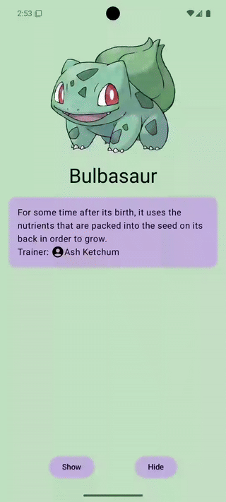
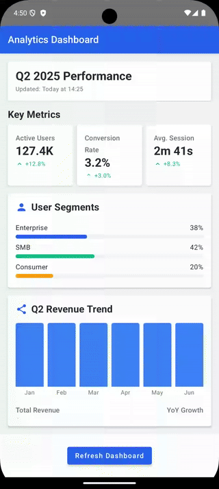
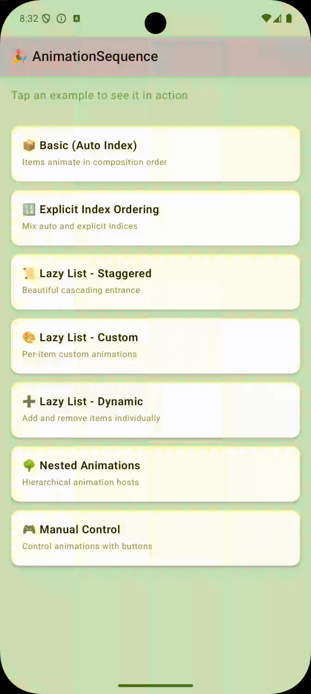

# 🎉 AnimationSequence

[](https://search.maven.org/artifact/io.github.pauloaapereira/animatedsequence)

**AnimationSequence** is a powerful yet intuitive Jetpack Compose library designed to simplify sequential animations in your Android apps. Easily orchestrate elegant, responsive, and hierarchical animations with minimal effort, enhancing user experience and bringing your UI to life.

<p align="center">
  
  
</p>

---

## 🌍 Compose Multiplatform Support!

Since **version 1.1.0**, `AnimationSequence` supports **Jetpack Compose Multiplatform**, allowing you to create rich animated UIs not only for Android, but also for **iOS**, **Desktop** and **Web (Wasm)** (where supported).

Available on **Maven Central** with coordinates: `io.github.pauloaapereira:animatedsequence`.

---

## ✨ Why Use AnimationSequence?

- ✅ **Simple & Intuitive**: Effortlessly animate elements sequentially — no manual index management needed!
- ✅ **Multiplatform Ready**: Works across Android, iOS, Desktop, and Web (Wasm).
- ✅ **Highly Customizable**: Full control over individual animations, delays, and transitions.
- ✅ **Hierarchical Animations**: Seamlessly manage nested animations.
- ✅ **Lazy List Support**: Beautiful staggered animations for LazyColumn/LazyRow/LazyGrid.
- ✅ **Automatic Ordering**: Items animate in composition order, or use explicit indices for precise control.
- ✅ **Robust**: Efficient resource cleanup and error handling built-in.

---

## 🚀 Quick Start

Here's a simple example to get you started:

```kotlin
AnimationSequenceHost {
    AnimatedItem {
        Text("Hello, Compose Animations!")
    }
    AnimatedItem {
        Button(onClick = {}) { Text("Animated Button") }
    }
}
```

---

## 🎬 Examples Gallery

The sample app includes 7 examples showcasing different features. Here's what each one demonstrates:

### 📦 Basic (Auto Index)

Items animate sequentially in the order they're composed — no manual index management needed!

<p align="center">
  
</p>

---

### 🔢 Explicit Index Ordering

Mix automatic and explicit indices. Explicit indices reserve specific slots; auto items fill the gaps.

<p align="center">
  
</p>

---

### 📜 Lazy List - Staggered

Beautiful cascading entrance animations for `LazyColumn`. Items animate once and don't re-animate when scrolled back into view.

<p align="center">
  
</p>

---

### 🎨 Lazy List - Custom Animations

Full control over enter/exit transitions per item. Different items can have different animations (scale, slide left, slide right).

<p align="center">
  
</p>

---

### ➕ Lazy List - Dynamic Items

Add and remove items with proper enter/exit animations using `trackItems()`. Removed items animate out before being disposed.

<p align="center">
  
</p>

---

### 🌳 Nested Animations

Hierarchical animation hosts. Child animations play after their parent, and when the parent exits, children exit first.

<p align="center">
  
</p>

---

### 🎮 Manual Control

Control animations programmatically with `enter()` and `exit()` functions. Perfect for custom triggers and user interactions.

<p align="center">
  
</p>

---

## 📖 Detailed Usage

### 📌 AnimationSequenceHost

The `AnimationSequenceHost` composable is the core of this library, managing the sequential animation flow.

**Parameters:**

- `modifier: Modifier` *(optional)* - Modifier to be applied to the host container.
- `startByDefault: Boolean` *(optional, default: `true`)* - Automatically starts animations upon composition if set to `true`.
- `content: @Composable (scope: SequentialAnimationScope) -> Unit` - The composable content, providing access to the `SequentialAnimationScope` for granular animation control.

### SequentialAnimationScope

Provides detailed control over animations:

- `enter()` - Animates all items sequentially.
- `exit(all: Boolean = false)` - Animates exit transitions sequentially. When `all` is `true`, exits all animations simultaneously.
- `enter(key: Int)` - Starts the enter animation for a specific item by its hash key.
- `exit(key: Int)` - Starts the exit animation for a specific item by its hash key.
- `isAnimating()` - Returns `true` if an animation sequence is currently in progress.

### 🖌️ AnimatedItem

Defines individual animated components within the `AnimationSequenceHost`.

**Automatic Ordering:** Items animate in the order they are composed — no need to specify indices manually!

```kotlin
AnimationSequenceHost {
    AnimatedItem { Text("Animates 1st") }
    AnimatedItem { Text("Animates 2nd") }
    AnimatedItem { Text("Animates 3rd") }
}
```

**Parameters:**

- `modifier: Modifier` *(optional)* - Modifier applied to the animated content.
- `key: Any?` *(optional)* - Stable key for identity. Required for lazy lists.
- `index: Int?` *(optional)* - Explicit slot to reserve in the animation order. If null, automatically assigned based on composition order.
- `animateOnce: Boolean` *(optional, default: `false`)* - If true, item only animates on first appearance.
- `delayAfterAnimation: Long` *(optional, default: `400ms`)* - Delay before the next animation starts.
- `enter: EnterTransition` *(optional, default: `fadeIn` with 300ms duration)* - Defines the animation when entering.
- `exit: ExitTransition` *(optional, default: `fadeOut` with 300ms duration)* - Defines the animation when exiting.
- `content: @Composable () -> Unit` - The content to be animated.

**Mixing Explicit and Auto Indices:**

Explicit indices reserve specific slots; auto items fill the remaining slots:

```kotlin
AnimationSequenceHost {
    AnimatedItem { Text("A") }              // Auto → slot 0
    AnimatedItem(index = 5) { Text("B") }   // Explicit → slot 5
    AnimatedItem { Text("C") }              // Auto → slot 1
}
// Animation order: A (0) → C (1) → B (5)
```

## 📜 Lazy List Animations

Beautiful staggered animations for `LazyColumn`, `LazyRow`, and `LazyGrid` with a clean, scoped API.

### Basic Usage

Wrap your lazy list in `LazyAnimationHost`:

```kotlin
LazyAnimationHost {
    LazyColumn {
        animatedItems(items, key = { it.id }) { item ->
            ListItemContent(item)
        }
    }
}
```

That's it! Items animate with a staggered fade-in effect and won't re-animate when scrolled back into view.

### Custom Stagger Timing

```kotlin
LazyAnimationHost(staggerDelayMillis = 100) {
    LazyColumn {
        animatedItems(items, key = { it.id }) { item ->
            ListItemContent(item)
        }
    }
}
```

### Custom Animations Per Item

Full control over enter/exit transitions with access to the calculated stagger delay:

```kotlin
LazyAnimationHost(staggerDelayMillis = 80) {
    LazyColumn {
        animatedItems(
            items = myList,
            key = { it.id },
            enter = { index, item, staggerDelay ->
                // Use staggerDelay in your animation spec!
                if (item.isSpecial) {
                    scaleIn(tween(300, delayMillis = staggerDelay)) +
                    fadeIn(tween(300, delayMillis = staggerDelay))
                } else {
                    slideInHorizontally(tween(300, delayMillis = staggerDelay)) { it } +
                    fadeIn(tween(300, delayMillis = staggerDelay))
                }
            },
            exit = { _, _ -> fadeOut() }
        ) { item ->
            ListItemContent(item)
        }
    }
}
```

### LazyAnimationHost Parameters

- `staggerDelayMillis: Int` *(default: `50`)* - Delay between each item's animation.
- `defaultEnter: EnterTransition` *(default: `fadeIn(300ms)`)* - Default enter transition.
- `defaultExit: ExitTransition` *(default: `fadeOut(300ms)`)* - Default exit transition.

### LazyAnimationScope Functions

The scope provides access to useful functions:

- `reset()` - Clears all tracking and restarts stagger timing. Use to replay animations.
- `wasShown(key: Any)` - Check if an item has already been animated.

```kotlin
LazyAnimationHost { scope ->
    Button(onClick = { scope.reset() }) {
        Text("Replay Animations")
    }
    LazyColumn { ... }
}
```

### animatedItems Parameters

- `items: List<T>` - The list of items to display.
- `key: (T) -> Any` - **Required.** Stable, unique key for each item.
- `enter: ((index, item, staggerDelay) -> EnterTransition)?` - Custom enter transition per item.
- `exit: ((index, item) -> ExitTransition)?` - Custom exit transition per item.

> **Note:** Stagger is automatically applied only to initially visible items. Items scrolled into view later animate immediately without stagger delay.

### Dynamic Lists with Exit Animations

For lists where items are dynamically added/removed and you need **exit animations**, use `scope.trackItems()`:

```kotlin
var items by remember { mutableStateOf(listOf(1, 2, 3)) }

LazyAnimationHost { scope ->
    // trackItems manages visibility state for proper exit animations
    val animatedList = scope.trackItems(items, key = { it })
    
    LazyColumn {
        animatedItems(
            items = animatedList,
            enter = { _, _, _ -> slideInHorizontally { it } + fadeIn() },
            exit = { _, _ -> slideOutHorizontally { -it } + fadeOut() }
        ) { animatedItem ->
            ItemCard(
                item = animatedItem.data,  // Access actual data via .data
                onRemove = { items = items - animatedItem.data }
            )
        }
    }
}
```

**Why is this needed?** When items are removed from a LazyColumn, the composable is immediately disposed. `trackItems()` keeps removed items in composition until their exit animation completes.

### Benefits of LazyAnimationHost

- ✅ **Scoped State**: All animation state is scoped to the host — no global state!
- ✅ **Automatic Reset**: Navigate away and back, animations replay automatically.
- ✅ **Clean API**: No manual state management needed.
- ✅ **Consistent with AnimationSequenceHost**: Familiar pattern for the whole library.

---

## 🎯 Advanced Example

Use `SequentialAnimationScope` for detailed control:

```kotlin
AnimationSequenceHost(startByDefault = false) { scope ->
    LaunchedEffect(Unit) {
        scope.enter()        // Start all animations sequentially
    }

    AnimatedItem {
        Text("First Animated Item")
    }
    AnimatedItem {
        Text("Second Animated Item")
    }
    AnimatedItem {
        Text("Third Animated Item")
    }
}
```

## 🌳 Hierarchical Animations

Effortlessly manage nested animations:

```kotlin
AnimationSequenceHost {
    AnimatedItem {
        Text("Parent Animated Text")
    }

    AnimationSequenceHost {
        AnimatedItem {
            Text("Child Animated Text 1")
        }
        AnimatedItem {
            Text("Child Animated Text 2")
        }
    }
}
```

When the parent exits, all children automatically perform their exit animations sequentially.

## 🔄 Migration Guide

### From 1.x to 2.x

**Good news!** The library is **fully backward compatible**. Your existing code will continue to work without any changes.

#### What's New

1. **Automatic Indexing**: The `index` parameter is now **optional**. Items automatically animate in composition order:
   ```kotlin
   // Before (still works!)
   AnimatedItem(index = 0) { Text("First") }
   AnimatedItem(index = 1) { Text("Second") }

   // After (simpler!)
   AnimatedItem { Text("First") }
   AnimatedItem { Text("Second") }
   ```

2. **Lazy List Support**: New `LazyAnimationHost` and `animatedItems` for beautiful staggered animations in lazy lists.

3. **New Parameters**: `key` and `animateOnce` for advanced use cases (lazy lists, conditional items).

#### Breaking Changes

None! All existing APIs work exactly as before.

---

## ⚙️ Installation

**Step 1. Add the Maven Central repository** (if not already included)**

In your `settings.gradle.kts` (or `settings.gradle`):

```kotlin
dependencyResolutionManagement {
    repositoriesMode.set(RepositoriesMode.FAIL_ON_PROJECT_REPOS)
    repositories {
        mavenCentral()
        // others ...
    }
}
```

**Step 2. Add the dependency in your `build.gradle.kts`:**

```kotlin
dependencies {
    implementation("io.github.pauloaapereira:animatedsequence:<version>")
}
```

Replace `<version>` with the latest release version. [](https://search.maven.org/artifact/io.github.pauloaapereira/animatedsequence)

## ▶️ Running the Samples

Want to see `AnimationSequence` in action? We've included a full **multiplatform sample app** in the `sample/` folder with targets for **Android**, **iOS**, **Desktop**, and **Web**.

### 🛠️ Steps to Run:

1. **Clone the repository**

```bash
git clone https://github.com/pauloaapereira/AnimatedSequence.git
cd AnimatedSequence
```

---

### 📱 Android

If you're using **Android Studio**, the Android sample should be **runnable right away**.  
The IDE will automatically detect the run configuration from the `androidApp` module.

---

### 🍏 iOS

You may need to manually create a run configuration the first time:

1. Go to **Run > Edit Configurations**
2. Click the **`+`** button → select **iOS Application**
3. Select the `.xcodeproj` file inside the `iosApp/` folder (root of the project)
4. Choose the **`iosApp`** scheme and **Debug** configuration
5. Select an execution target (usually auto-selected)

> ✅ You can now run the iOS sample on a simulator or a real device.

---

### 🖥️ Desktop

To run the desktop sample:

```bash
./gradlew :sample:run
```

### 🌐 Web (Wasm)

To run the WebAssembly sample in development mode:

```bash
./gradlew :sample:wasmJsBrowserDevelopmentRun -t
```

> 🔁 The `-t` flag enables **continuous build**, so it will reload when you make changes.

> 🌐 The app will open in your default browser, usually at [http://localhost:8080](http://localhost:8080).

---

You can explore and modify each sample target in the `sample/` folder as you'd like.

If you run into any issues or missing configurations, feel free to [open an issue](https://github.com/pauloaapereira/AnimatedSequence/issues) — contributions and improvements are welcome!

## 📌 Contribution

Contributions, issues, and feature requests are welcome! Feel free to check the [issues page](https://github.com/pauloaapereira/AnimatedSequence/issues).

## 📄 License

Distributed under the Apache License 2.0.
<a href="https://opensource.org/licenses/Apache-2.0"></a>

## Find this repository useful? :]

Feel free to support me and my new content on: 

<a href="https://www.buymeacoffee.com/ppereira"></a> 

<a href="https://www.paypal.com/donate?hosted_button_id=68Q9V7ZGGAW2W"></a> 

---

Happy Animating! ✨🚀
